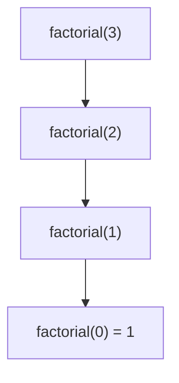

# CS101 Introduction to Programming - Lecture Notes

Department of Computer Science. Approved teaching material, 2026-27.

## Unit 1: Variables, Types and Expressions

### Variables and assignment

A variable is a name that refers to a value stored in memory. In Python, the assignment statement `x = 5` binds the name `x` to the integer object `5`. Assignment evaluates the right-hand side first and then binds the name on the left. Re-assigning a variable, for example `x = x + 1`, reads the old value, computes a new value and rebinds the name to the new object.

Python is dynamically typed: a variable does not have a fixed type, the value it refers to does. After `x = 5` the expression `type(x)` gives `int`; after `x = "five"` it gives `str`.

### Built-in data types

The core types are `int` (whole numbers such as 42), `float` (real numbers such as 3.14), `bool` (`True` or `False`) and `str` (text such as "hello"). Converting between types is explicit: `int("7")` gives 7, `str(7)` gives "7" and `float(2)` gives 2.0. Converting the string "abc" with `int` raises a `ValueError`.

### Arithmetic expressions and operator precedence

Python follows the usual mathematical precedence rules. Exponentiation `**` binds tightest, then unary minus, then multiplication `*`, true division `/`, floor division `//` and remainder `%`, and finally addition `+` and subtraction `-`. Operators of the same precedence are evaluated left to right, except `**`, which is right-associative: `2 ** 3 ** 2` equals `2 ** 9 = 512`.

Examples: `2 + 3 * 4` evaluates to 14 because multiplication happens first. `(2 + 3) * 4` evaluates to 20 because parentheses override precedence. `7 // 2` is 3 and `7 % 2` is 1. The division `7 / 2` always produces the float 3.5.

The quadratic formula $x = \frac{-b \pm \sqrt{b^2 - 4ac}}{2a}$ must be written with parentheses in code: `(-b + (b**2 - 4*a*c) ** 0.5) / (2*a)`.

### Boolean expressions

Comparison operators (`==`, `!=`, `<`, `<=`, `>`, `>=`) produce booleans. The logical operators are `not`, `and` and `or`, with precedence in that order: `not` first, then `and`, then `or`. So `True or False and False` is `True`, because `and` is evaluated before `or`. Python short-circuits: in `a and b`, `b` is not evaluated when `a` is false.

## Unit 2: Control Flow

### Conditional statements

The `if` statement runs a block only when its condition is true. `elif` adds further conditions and `else` handles every remaining case. Exactly one branch of an `if/elif/else` chain runs.

```python
if score >= 80:
    grade = "A"
elif score >= 60:
    grade = "B"
else:
    grade = "C"
```

### Loops

A `while` loop repeats as long as its condition remains true; the body must eventually make the condition false or the loop never ends. A `for` loop iterates over the items of a sequence: `for i in range(5)` runs the body with i = 0, 1, 2, 3, 4. `range(a, b)` stops before b. The statement `break` leaves the loop immediately and `continue` skips to the next iteration.

A common pattern is the accumulator: start with `total = 0` and add each item inside the loop. Summing 1 to n can be done with `for i in range(1, n + 1): total += i`.

## Unit 3: Functions and Modularity

### Defining functions

A function packages a computation under a name so it can be reused. `def area(w, h):` defines a function with two parameters; `return w * h` sends a value back to the caller. A function without a `return` statement returns `None`. Parameters are local variables: assigning to them inside the function does not change the caller's variables.

Decomposition means splitting a problem into smaller functions, each with one clear job, such as `read_marks()`, `average(marks)` and `report(avg)`.

### Recursion

A recursive function calls itself on a smaller version of the problem. Every recursive function needs a base case that stops the recursion, and a recursive case that moves towards the base case.

```python
def factorial(n):
    if n == 0:          # base case
        return 1
    return n * factorial(n - 1)   # recursive case
```

Tracing `factorial(3)`: it calls `factorial(2)`, which calls `factorial(1)`, which calls `factorial(0)`, which returns 1. The results are multiplied on the way back: 1 x 1 = 1, 2 x 1 = 2, 3 x 2 = 6. Forgetting the base case causes infinite recursion and Python raises a `RecursionError`.


